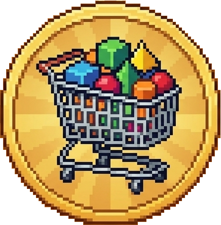
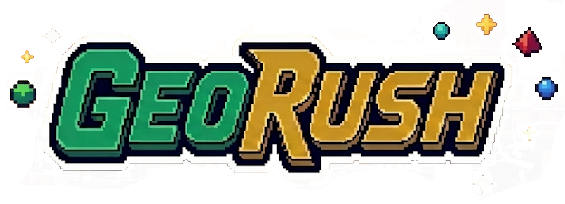
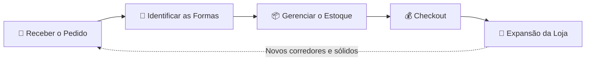
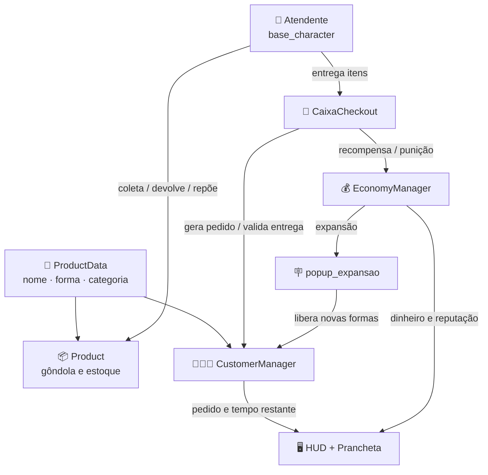

<div align="center">





### *Atenda rápido. Pense em formas. Domine a geometria.*

**Um Jogo Sério 2D top-down onde a matemática vira caos de supermercado.**

<br>


<br>

[🎮 **Jogar agora**](#-jogue-agora) · [📖 Tutorial](#-manual-do-atendente) · [⌨️ Controles](#️-controles) · [🛠️ Executar](#️-como-executar) · [🏗️ Arquitetura](#️-arquitetura-do-código) · [👥 Equipe](#-equipe)

</div>

---

## 📌 Sobre o Projeto

O **GeoRush** é um **Jogo Sério** **Educacional** 2D top-down desenvolvido como parte da disciplina de **PAC Extensionista** do curso de **Engenharia de Software** (Católica SC).

O objetivo é auxiliar alunos de **12 a 16 anos** no **reconhecimento e classificação de Sólidos Geométricos**, transformando a teoria matemática pesada em uma experiência de gameplay **lúdica, rápida e imersiva**.

<div align="center">

| 🔵 Esfera | 🥫 Cilindro | 📦 Paralelepípedo | 🔺 Pirâmide | 🍦 Cone |
|:---:|:---:|:---:|:---:|:---:|
| Maçã, bola... | Lata, tubo... | Caixa, livro... | Pirâmide | Cone |

</div>

---

## 🎮 O Jogo

Você é o atendente de um **supermercado caótico**. Os clientes chegam, pedem produtos pelo nome, e cabe a você traduzir cada item para sua **forma geométrica** e entregar tudo antes que o tempo acabe.

### Core Game Loop



| Etapa | O que acontece |
|:---|:---|
| 🧾 **Receber o Pedido** | Atenda clientes gerados proceduralmente no caixa. |
| 📐 **Identificar as Formas** | Traduza a lista de compras (ex: *"Maçã"*, *"Lata"*, *"Caixa"*) para suas formas geométricas (*Esfera*, *Cilindro*, *Paralelepípedo*). |
| 📦 **Gerenciar o Estoque** | Colete itens nas prateleiras, devolva os errados e reponha estoques vazios com o dinheiro do caixa. |
| ⏱️ **Checkout** | Entregue os produtos antes que o tempo se esgote. |
| 🏪 **Expansão** | Acumule dinheiro e reputação para expandir a loja, revelando novos corredores e sólidos mais complexos. |

---

## ⌨️ Controles

O jogo é jogado pelo **teclado**.

| Tecla | Ação |
|:---:|:---|
| <kbd>W</kbd> <kbd>A</kbd> <kbd>S</kbd> <kbd>D</kbd> / <kbd>↑</kbd> <kbd>←</kbd> <kbd>↓</kbd> <kbd>→</kbd> | Movimentar o personagem pelo supermercado |
| <kbd>E</kbd> | Interagir (pegar pedido no caixa / coletar produto na gôndola / finalizar entrega) |
| <kbd>R</kbd> | Devolver o último produto coletado à prateleira correspondente |
| <kbd>F</kbd> | Repor estoque da prateleira *(custa dinheiro do caixa)* |
| <kbd>Tab</kbd> | Abrir/fechar a prancheta (lista de compras atual) |
| <kbd>Esc</kbd> | Pausar o jogo |

---

## 📖 Manual do Atendente

> 💡 **Atenção, novo funcionário!** Como o GeoRush foca na ação direta e não possui um tutorial interativo interno até o presente momento, leia este guia rápido antes de abrir o caixa no seu primeiro turno.

### 🕹️ Passo a Passo do Turno

<table>
<tr>
<td width="50%" valign="top">

#### 1️⃣ Atenda no Caixa
Quando o cliente parar no balcão de *Checkout*, aproxime-se e pressione <kbd>E</kbd>. O pedido será registrado imediatamente na sua prancheta e o cronômetro começará a rodar.

</td>
<td width="50%" valign="top">

#### 2️⃣ Consulte a Prancheta e Traduza
Pressione <kbd>Tab</kbd> a qualquer momento para abrir ou fechar sua prancheta. Nela, você verá os sólidos geométricos solicitados e deverá buscar nas gôndolas os produtos do dia a dia que correspondem aquela forma.

</td>
</tr>
<tr>
<td width="50%" valign="top">

#### 3️⃣ Colete, Corrija e Reabasteça
* **Pegar item:** Encoste na gôndola certa e aperte <kbd>E</kbd>.
* **Pegou errado?** Volte à gôndola do item e aperte <kbd>R</kbd> para devolvê-lo.
* **Acabou o estoque?** Pressione <kbd>F</kbd> em frente à prateleira vazia para comprar reposição.

</td>
<td width="50%" valign="top">

#### 4️⃣ Finalize a Entrega e Expanda
Com todos os itens corretos em mãos, retorne ao balcão do caixa e pressione <kbd>E</kbd> para entregar o pedido. Ao atingir a meta de clientes atendidos com sucesso, uma nova expansão chega ao mercado!

</td>
</tr>
</table>

### ⚖️ Regras de Ouro do Supermercado

| Indicador | Mecânica | Impacto na Partida |
|:---:|:---|:---|
| 🟢 **Entrega Perfeita** | Entregar todos os sólidos corretos antes do tempo acabar. | Gera **lucro em dinheiro ($)** no caixa e aumenta a **Reputação**. |
| 🟡 **Gôndola Vazia** | As prateleiras têm quantidade limitada de produtos. | Reabastecer com <kbd>F</kbd> consome dinheiro do cofre; gerencie bem o seu saldo! |
| 🔴 **Erro ou Atraso** | Entregar formas incorretas ou deixar a barra de paciência esgotar. | O cliente vai embora irritado, aplica multa e derruba sua **Reputação**. |

---

## ⚙️ Principais Funcionalidades Técnicas

<table>
<tr>
<td width="50%" valign="top">

### 🧍 Geração Procedural de NPCs
Combinação aleatória de dezenas de texturas (roupas, peles e cabelos), gerando mais de **7 mil clientes visualmente únicos**.

</td>
<td width="50%" valign="top">

### 🤖 Máquina de Estados de IA
Clientes navegam por **Waypoints**, formam filas de forma inteligente, reagem emocionalmente ao atendimento.

</td>
</tr>
<tr>
<td width="50%" valign="top">

### 💸 Economia Dinâmica
O **EconomyManager** escala ganhos e penalidades com base no tempo de resposta e na precisão do jogador.

</td>
<td width="50%" valign="top">

### 📈 Dificuldade Progressiva
O **CustomerManager** aumenta a complexidade (mais itens, menos tempo) conforme você expande os setores do mercado.

</td>
</tr>
</table>

---

## 🌐 Jogue Agora

Escolha a melhor forma de experimentar o **GeoRush** de acordo com sua preferência:

<div align="center">

| Plataforma / Modo | Acesso / Ação | Descrição |
| :---: | :--- | :--- |
| 🌍 **Navegador** | [](https://gabrielbruno.itch.io/georush) | Jogue direto pelo navegador web, sem nenhuma instalação necessária. |
| 🗂️ **Executável** | [](https://github.com/GabBruno/GeoRush/releases) | Baixe o arquivo `.exe` na aba de Releases e execute. |
| 💻 **Código-Fonte** | [](https://github.com/GabBruno/GeoRush) | Clone o repositório e abra o projeto utilizando a Godot Engine. |

</div>

> 💡 **Procurando tutoriais?** Caso queira entender as regras, os comandos de teclado e o fluxo de gameplay detalhado, siga as instruções completas listadas na seção [**Como Executar**](#️-como-executar) abaixo.

---

## 💻 Requisitos do Sistema

<table>
<tr>
<td width="33%" valign="top">

### 🌍 Web (Navegador)
* **Navegador:** Chrome, Firefox, Edge ou Opera atualizados
* **Tecnologia:** Suporte a WebGL 2.0 / WebAssembly
* **Entrada:** Teclado físico

</td>
<td width="33%" valign="top">

### 📦 Executável (Release)
* **SO:** Windows 10 ou 11 (64-bit)
* **Vídeo:** Placa integrada ou dedicada com suporte a Vulkan 1.0 ou OpenGL 3.3
* **Entrada:** Teclado físico

</td>
<td width="33%" valign="top">

### 🛠️ Código-Fonte
* **SO:** Windows 10 ou 11 (64-bit)
* **Engine:** **Godot Engine v4.7.X** (versão *Standard* / GDScript — sem necessidade de .NET)

</td>
</tr>
</table>

---

## 🛠️ Como Executar

O projeto usa a arquitetura nativa da **Godot Engine**, portanto **não requer bibliotecas externas** (NPM, Pip, etc). Escolha uma das três opções abaixo:

### 1. 🌍 Via Web / Navegador

1. Acesse a página oficial no Itch.io [**Clicando Aqui**](https://gabrielbruno.itch.io/georush).
2. Clique no botão **Run Game** no centro da tela.
3. Clique uma vez dentro da janela do jogo para ativar o foco do teclado e divirta-se!

### 2. 📦 Via Executável Windows

Ideal para jogar nativamente no Windows sem precisar instalar a Godot Engine:

1. No menu lateral direito deste repositório no GitHub, acesse a aba **Releases**.
2. Na versão mais recente, baixe o arquivo executável disponível em **Assets**.
3. Execute o arquivo `GeoRush.exe` para iniciar o jogo.

### 3. 💻 Via Código-Fonte

**Pré-requisito:** [Godot Engine v4.7.X para Windows](https://godotengine.org/download) (versão *Standard*, sem necessidade de .NET).

```bash
# 1. Clone o repositório
git clone https://github.com/GabBruno/GeoRush.git
```

1. Abra a **Godot Engine** e clique em **Import**.
2. Navegue até a pasta clonada e selecione o arquivo `project.godot`.
3. Clique em **Import & Edit**.
4. Pressione <kbd>F5</kbd> para compilar e iniciar o jogo em modo Debug.

---

## ⚠️ Limitações Conhecidas

| Escopo | Limitação Atual |
|:---|:---|
| 📖 **Tutorial In-Game** | O jogo ainda não possui uma fase guiada interna; as instruções completas de gameplay são supridas pela seção [Manual do Atendente](#-manual-do-atendente) deste README. |
| ⌨️ **Dispositivos Móveis** | Embora a versão HTML5 rode no navegador, os controles exigem teclado físico (<kbd>WASD</kbd>, <kbd>E</kbd>, <kbd>R</kbd>, <kbd>F</kbd>, <kbd>Tab</kbd>) e não possuem botões virtuais (*touch*) para celulares ou tablets. |
| 💾 **Save System** | O progresso financeiro e as expansões da loja funcionam no formato *Arcade* (por sessão de partida), reiniciando caso o jogador feche o jogo ou atinja o *Game Over*. |

---

## 📄 Documentos

Todos os documentos de projeto, planejamento e arquitetura estão listados na pasta `Docs/` deste repositório. O documento principal é o **Game Design Document (GDD)**, onde você pode acessar a visão detalhada, as regras e toda a documentação de interface do jogo.

👉 Você pode acessar o GDD diretamente aqui: [`Docs/GeoRush GDD.pdf`](Docs/GeoRush%20GDD.pdf)

---

## 🏗️ Arquitetura do Código

O projeto adota boas práticas de **separação de responsabilidades** e **orientação a eventos**, organizado por **domínio** (núcleo, entidades, produtos, UI e fases) em vez de por tipo de arquivo.

```
GeoRush/
├── 📂 Assets/                    # Recursos visuais, sonoros e fontes
│   ├── Audio/                    #   Música (menu e fundo) e SFX
│   ├── Enviroment/               #   Tiles do cenário e porta
│   ├── Fonts/                    #   Pixelify Sans e RevMiniPixel
│   └── UI/                       #   Logo, ícones, prancheta, botões e barras
│
├── 📂 Docs/                      # Documentação do projeto
│   └── 📄 GeoRush GDD.pdf        # Game Design Document
│
├── 📂 Core/                      # Cérebro do jogo (regras e sistemas globais)
│   ├── customer_manager.gd/.tscn #   Pedidos, timers de paciência e sólidos liberados
│   ├── economy_manager.gd        #   Dinheiro, reputação, expansões e Game Over
│   ├── hud_manager.gd            #   HUD: tempo, dinheiro, reputação e expansão
│   └── product_data.gd           #   Resource que define um produto (nome, forma, categoria, ícone)
│
├── 📂 Entities/                  # Tudo que existe e se move/interage no mercado
│   ├── Characters/
│   │   ├── base_character.gd     #   Atendente: movimento, carrinho e interações
│   │   ├── cliente.gd            #   Cliente: waypoints, fila e reações
│   │   ├── atendente.tscn · cliente.tscn · base_character.tscn
│   │   ├── Reactions/            #   Emojis de reação dos clientes
│   │   └── Visuals/              #   Camadas p/ geração procedural (Corpo, Cabelo, Roupa)
│   └── Interactables/
│       └── caixa_checkout.gd     #   Caixa: recebe pedido, valida entrega e paga
│
├── 📂 Products/                  # Catálogo de produtos
│   ├── product.gd                #   Gôndola: estoque, coleta, devolução e reposição
│   ├── base_products.tscn        #   Cena base reutilizada por todos os produtos
│   ├── Data/                     #   ProductData (.tres) de cada produto
│   ├── Icons/                    #   Ícones usados na prancheta e no carrinho
│   └── Scenes/                   #   Uma cena por produto (maçã, lata de milho...)
│
├── 📂 Levels/                    # Cenas das fases
│   ├── game_level.tscn
│   └── mercado_manager.tscn      #   Montagem do mercado, prateleiras e caixa
│
├── 📂 UI/                        # Menus e pop-ups
│   ├── menu_principal.gd/.tscn
│   ├── menu_pausa.gd/.tscn
│   ├── popup_expansao.gd/.tscn
│   └── theme_botoes.tres         #   Tema compartilhado dos botões
│
├── 📄 project.godot              # Configuração do projeto e AutoLoads
└── 📄 export_presets.cfg         # Presets de exportação (HTML5/WASM)
```

### 🔗 AutoLoads (Singletons)

| Singleton | Arquivo | Responsabilidade |
|:---|:---|:---|
| 💰 **EconomyManager** | `Core/economy_manager.gd` | Controla o cofre global, a reputação, o nível de expansão e a meta de clientes atendidos. |
| 🧑‍🤝‍🧑 **CustomerManager** | `Core/customer_manager.tscn` | Gera os pedidos, controla o timer de paciência e libera novos sólidos geométricos conforme a loja expande. |

### 🧩 Como as peças conversam



> 💡 **Dados desacoplados da lógica:** cada produto é um `Resource` (`ProductData`) editável direto no Inspector da Godot. Para adicionar um item novo, basta criar um `.tres`, uma cena em `Products/Scenes/` e posicioná-la no mercado, sem alterar nenhum script.

---

## 👥 Equipe

<div align="center">

| Integrantes |
| :---: |
| [**Gabriel Bruno**](https://github.com/GabBruno)        |
| [**Gabriel da Cunha**](https://github.com/GChandrone)   |
| [**Iasmin Krueger**](https://github.com/Iasminkrueger)  |
| [**Julia Seger**](https://github.com/juliasgr)          |
| [**Vitor Turmina**](https://github.com/vTurmina)        |

</div>

---

<div align="center">

Projeto desenvolvido para a disciplina de **PAC Extensionista** · Engenharia de Software · **Católica SC**

⭐ Se gostou do projeto, deixe uma estrela no repositório!

</div>
