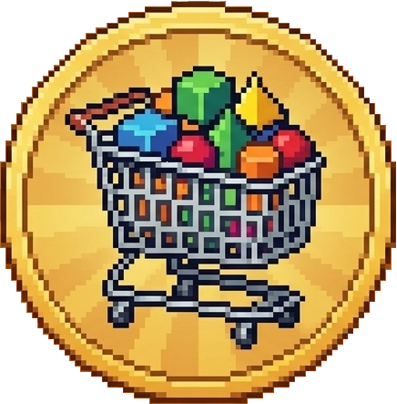
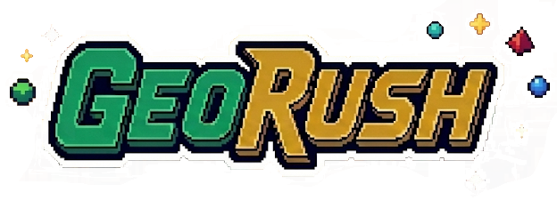
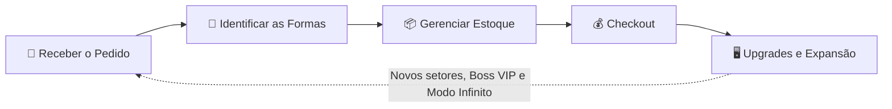
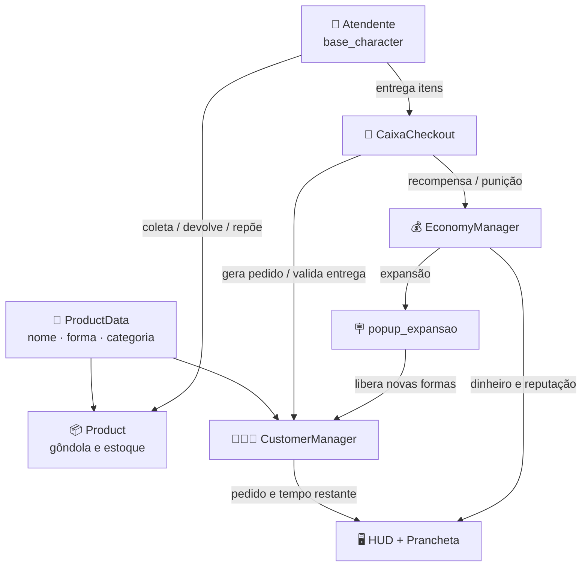

<div align="center">





### *Atenda rápido. Pense em formas. Domine a geometria.*

**Um Jogo Sério 2D top-down onde a matemática vira caos de supermercado.**

<br>


-0078D6?style=for-the-badge&logo=windows&logoColor=white)


<br>

[🎮 **Jogar agora**](#-jogue-agora) · [📖 Tutorial](#-manual-do-atendente) · [⌨️ Controles](#️-controles) · [🛠️ Executar](#️-como-executar) · [🏗️ Arquitetura](#️-arquitetura-do-código) · [👥 Equipe](#-equipe)

</div>

---

## 📌 Sobre o Projeto

O **GeoRush** é um **Jogo Sério Educacional** 2D top-down desenvolvido como parte da disciplina de **PAC Extensionista** do curso de **Engenharia de Software** (Católica SC).

O objetivo é auxiliar alunos de **12 a 16 anos** no **reconhecimento e classificação de Sólidos Geométricos**, transformando a teoria matemática pesada em uma experiência de gameplay **lúdica, rápida e imersiva**.

<div align="center">

| 🔵 Esfera | 🥫 Cilindro | 📦 Paralelepípedo |
|:---:|:---:|:---:|
| Setor 1 (3 produtos) | Setor 2 (3 produtos) | Setor 3 (3 produtos) |

</div>

> *A versão atual conta com **3 setores geométricos ativos** (9 produtos no total), além de desafio de **Boss Final (Crítico Supremo)** e **Modo Infinito**. Novos sólidos (como Pirâmide e Cone) ficam mapeados para expansões futuras.*

---

## 🎮 O Jogo

Você é o atendente de um **supermercado caótico**. Os clientes entram na fila com paciência limitada e fazem pedidos tanto pelo nome do produto quanto diretamente pela **forma geométrica** (*"Qualquer Esfera/Cilindro/Paralelepípedo"*). Cabe a você traduzir cada item, controlar o estoque, investir em upgrades e sobreviver até o desafio do **Crítico Supremo**.

### Core Game Loop



| Etapa | O que acontece |
|:---|:---|
| 🧾 **Receber o Pedido** | Atenda clientes na fila antes que a paciência acabe; os pedidos podem exigir produtos específicos ou qualquer item de um sólido geométrico. |
| 📐 **Identificar as Formas** | Consulte a prancheta (com ícones em pixel art para cada sólido e modo compacto automático para listas grandes) e localize os itens nos setores. |
| 📦 **Gerenciar o Estoque** | Colete itens nas gôndolas com contador visual (`Estoque: X/Y`), devolva itens errados e reponha prateleiras vazias com o dinheiro do caixa. |
| ⏱️ **Checkout** | Entregue o carrinho correto antes que o cronômetro zere para lucrar e ganhar gorjeta por agilidade. |
| 🖥️ **Upgrades e Expansão** | Invista no **Computador de Upgrades** (*Tênis*, *Gôndolas Maiores* e *Repositor Automático*), desbloqueie novos setores, enfrente o **Boss Final (Crítico Supremo)** e libere o **Modo Infinito**. |

---

## ⌨️ Controles

O jogo é jogado pelo **teclado** (com suporte a clique do mouse no tutorial e nos diálogos).

| Tecla | Ação |
|:---:|:---|
| <kbd>W</kbd> <kbd>A</kbd> <kbd>S</kbd> <kbd>D</kbd> / <kbd>↑</kbd> <kbd>←</kbd> <kbd>↓</kbd> <kbd>→</kbd> | Movimentar o personagem pelo supermercado |
| <kbd>E</kbd> | Interagir (atender no caixa, coletar produto na gôndola, entregar pedido, acessar o Computador de Upgrades e avançar diálogos do Boss) |
| <kbd>R</kbd> | Devolver o último produto coletado à prateleira correspondente |
| <kbd>Shift</kbd> + <kbd>R</kbd> | Devolver todos os itens do carrinho de uma vez |
| <kbd>F</kbd> | Repor estoque da prateleira *($1.50 por unidade)* |
| <kbd>Tab</kbd> | Abrir/fechar a prancheta (lista de compras atual) |
| <kbd>Espaço</kbd> / **Clique** | Avançar diálogos do Boss VIP e interagir com o tutorial |
| <kbd>Esc</kbd> | Pausar o jogo |

---

## 📖 Manual do Atendente

> 💡 **Tutorial Interativo In-Game:** ao iniciar sua partida, o GeoRush oferece um **tour guiado de câmera com holofote** pelos 4 pontos principais da loja (*Porta*, *Caixa*, *Gôndolas* e *Computador*). Ao final do tour, você pode escolher entre fazer o **Pedido Guiado** (com fila pausada e cliente único) ou **Seguir Sozinho** — além de poder pular o tutorial a qualquer momento.

### 🕹️ Passo a Passo do Turno

<table>
<tr>
<td width="50%" valign="top">

#### 1️⃣ Atenda no Caixa (Olho na Paciência!)
Os clientes aguardam na fila com um relógio radial vermelho de paciência acima da cabeça. Aproxime-se do balcão de *Checkout* e pressione <kbd>E</kbd> para registrar o pedido na prancheta e iniciar o atendimento.

</td>
<td width="50%" valign="top">

#### 2️⃣ Consulte a Prancheta e Traduza
Pressione <kbd>Tab</kbd> a qualquer momento para abrir ou fechar sua prancheta. Ela exibe tanto produtos específicos quanto pedidos diretos por forma geométrica com ícones em pixel art (e ativa modo compacto automático em listas extensas).

</td>
</tr>
<tr>
<td width="50%" valign="top">

#### 3️⃣ Colete, Corrija e Reabasteça
- **Pegar item:** encoste na gôndola certa e aperte <kbd>E</kbd>.
- **Pegou errado?** aperte <kbd>R</kbd> para devolver o último item ou <kbd>Shift</kbd> + <kbd>R</kbd> para esvaziar o carrinho.
- **Acabou o estoque?** acompanhe o contador `Estoque: X/Y` e pressione <kbd>F</kbd> para repor (`$1.50/un.`).

</td>
<td width="50%" valign="top">

#### 4️⃣ Evolua a Loja e Enfrente o Boss VIP
Com os itens em mãos, volte ao caixa e pressione <kbd>E</kbd>. Use o lucro no **Computador de Upgrades** (*Tênis* `$120`, *Gôndolas Maiores* `$240`, *Repositor Automático* `$360`), expanda os 3 setores e vença o **Crítico Supremo** (todos os 9 produtos em 55s) para desbloquear o **Modo Infinito**!

</td>
</tr>
</table>

### ⚖️ Regras de Ouro do Supermercado

| Indicador | Mecânica | Impacto na Partida |
|:---:|:---|:---|
| 🟢 **Entrega Perfeita** | Entregar todos os itens e sólidos corretos antes do tempo acabar. | Rende **$3.00/item** + **$0.25/s** de gorjeta e aumenta a **Reputação** (mais estrelas aceleram a fila e aumentam ganhos e paciência). |
| 🟡 **Estoque e Upgrades** | Prateleiras têm capacidade limitada (`Estoque: X/Y`) e upgrades otimizam o turno. | Repor manualmente custa **$1.50/un.**; investir em **Gôndolas Maiores** e **Repositor Automático** (ciclo de 12s) evita gargalos. |
| 🟠 **Paciência na Fila** | Cada cliente espera na fila (base `32s`, com dreno menor no fundo da fila) e reclama aos `35%`. | Se zerar, o cliente vai embora irritado e derruba **-5 de Reputação**. |
| 🔴 **Erro ou Tempo Esgotado** | Entregar formas/itens incorretos ou estourar o cronômetro do pedido. | Aplica multa de **-$10** e **-10 de Reputação** (zerar a reputação leva ao *Game Over*). |
| 👑 **Boss VIP (Crítico Supremo)** | A loja esvazia para a cutscene e ele pede todos os **9 produtos do mercado** (`13 itens`) em **55s**. | Vitória garante bônus em dinheiro e libera o **Modo Infinito**; derrota zera a barra do Boss e tira **-5 de Reputação**. |

---

## ⚙️ Principais Funcionalidades Técnicas

<table>
<tr>
<td width="50%" valign="top">

### 🔦 Tutorial Interativo com Holofote
Tour automatizado de câmera em 4 pontos com shader de holofote animado, trava de cliente único durante o pedido guiado e opção de pular livremente.

</td>
<td width="50%" valign="top">

### 🧍 NPCs Procedurais, Falas e Anticolisão
Mais de **7 mil combinações visuais**, 5 bancos de falas antirrepetição em balões animados, rota segura de saída acima da fila e checagem anticolisão entre clientes.

</td>
</tr>
<tr>
<td width="50%" valign="top">

### ⏱️ Paciência Radial e Economia Dinâmica
Relógio visual em shader radial sobre cada cliente, dreno escalonado pela posição na fila e curva de **Reputação × Ritmo da Fila** (1★ a 5★) gerenciada pelo `EconomyManager`.

</td>
<td width="50%" valign="top">

### 🖥️ Upgrades, Boss VIP e Modo Infinito
Loja interativa no computador (*Tênis*, *Gôndolas Maiores* com limite visual proporcional e *Repositor Automático*), caixa de diálogo exclusiva do Boss em `CanvasLayer` e progressão contínua pós-Boss.

</td>
</tr>
<tr>
<td width="50%" valign="top">

### 🎵 Trilha Sonora Dinâmica
Faixas dedicadas para Fase, Boss Final (em loop), Vitória e Game Over, com controle global por grupos para impedir sobreposição de áudio entre transições.

</td>
<td width="50%" valign="top">

### 🚀 CI/CD e Testes Automatizados
Pipeline em **GitHub Actions** com `gdlint`, compilação e testes headless na Godot 4, revisão de dependências (Dependabot), versionamento SemVer e **GitHub Releases** com rollback.

</td>
</tr>
</table>

---

## 🌐 Jogue Agora

Escolha a melhor forma de experimentar o **GeoRush** de acordo com sua preferência:

<div align="center">

| Plataforma / Modo | Acesso / Ação | Descrição |
| :---: | :--- | :--- |
| 🌍 **Navegador** | [](https://gabrielbruno.itch.io/georush) | Jogue direto pelo navegador web, sem nenhuma instalação necessária. |
| 🗂️ **Executável** | [](https://github.com/GabBruno/GeoRush/releases) | Baixe o arquivo `.exe` na aba de Releases e execute no Windows. |
| 💻 **Código-Fonte** | [](https://github.com/GabBruno/GeoRush) | Clone o repositório e abra o projeto utilizando a Godot Engine. |

</div>

> 💡 **Dica:** para ver detalhes de cada opção ou rodar a suíte de testes localmente, siga as instruções em [**Como Executar**](#️-como-executar) abaixo.

---

## 💻 Requisitos do Sistema

<table>
<tr>
<td width="33%" valign="top">

### 🌍 Web (Navegador)
- **Navegador:** Chrome, Firefox, Edge ou Opera atualizados
- **Tecnologia:** Suporte a WebGL 2.0 / WebAssembly
- **Entrada:** Teclado físico (e mouse para menus/tutorial)

</td>
<td width="33%" valign="top">

### 📦 Executável (Release)
- **SO:** Windows 10 ou 11 (64-bit)
- **Vídeo:** Placa integrada ou dedicada com suporte a Vulkan 1.0 ou OpenGL 3.3
- **Entrada:** Teclado físico (e mouse para menus/tutorial)

</td>
<td width="33%" valign="top">

### 🛠️ Código-Fonte
- **SO:** Windows 10 ou 11 (64-bit)
- **Engine:** **Godot Engine v4.7.X** (versão *Standard* / GDScript — sem necessidade de .NET)

</td>
</tr>
</table>

---

## 🛠️ Como Executar

O jogo utiliza exclusivamente a arquitetura nativa da **Godot Engine**, portanto **não exige dependências externas para rodar**. Escolha uma das três opções abaixo:

### 1. 🌍 Via Web / Navegador

1. Acesse a página oficial no Itch.io [**Clicando Aqui**](https://gabrielbruno.itch.io/georush).
2. Clique no botão **Run Game** no centro da tela.
3. Clique uma vez dentro da janela do jogo para ativar o foco do teclado e divirta-se!

### 2. 📦 Via Executável Windows

Ideal para jogar nativamente no Windows sem precisar instalar a Godot Engine:

1. No menu lateral direito deste repositório no GitHub, acesse a aba **Releases**.
2. Na versão mais recente, baixe o arquivo executável disponível em **Assets**.
3. Extraia (se compactado) e execute **`GeoRush.exe`** para iniciar o jogo.
   > *Nota:* caso o Windows SmartScreen exiba um aviso por ser um executável independente, clique em **Mais informações** → **Executar assim mesmo**.

### 3. 💻 Via Código-Fonte

**Pré-requisito:** [Godot Engine v4.7.X para Windows](https://godotengine.org/download) (versão *Standard*, sem necessidade de .NET).

```bash
# 1. Clone o repositório
git clone [https://github.com/GabBruno/GeoRush.git](https://github.com/GabBruno/GeoRush.git)
cd GeoRush
```

1. Abra a **Godot Engine** e clique em **Import**.
2. Navegue até a pasta clonada e selecione o arquivo `project.godot`.
3. Clique em **Import & Edit**.
4. Pressione <kbd>F5</kbd> para compilar e iniciar o jogo em modo Debug.

---

## ⚠️ Limitações Conhecidas

| Escopo | Limitação Atual |
|:---|:---|
| ⌨️ **Dispositivos Móveis** | Embora a versão HTML5 rode no navegador, os controles exigem teclado físico (<kbd>WASD</kbd>, <kbd>E</kbd>, <kbd>R</kbd>, <kbd>Shift</kbd>+<kbd>R</kbd>, <kbd>F</kbd>, <kbd>Tab</kbd>) e não possuem botões virtuais (*touch*) para celulares ou tablets. |
| 💾 **Save System** | O progresso financeiro, upgrades e expansões da loja funcionam no formato *Arcade* (por sessão de partida), reiniciando caso o jogador feche o jogo ou atinja o *Game Over*. |

---

## 📄 Documentos

Todos os documentos de projeto, planejamento e arquitetura estão listados na pasta `Docs/` deste repositório. O documento principal é o **Game Design Document (GDD)**, onde você pode acessar a visão detalhada, as regras e toda a documentação de interface do jogo.

👉 Você pode acessar o GDD diretamente aqui: [`Docs/GeoRush GDD.pdf`](Docs/GeoRush%20GDD.pdf)

---

## 🏗️ Arquitetura do Código

O projeto adota boas práticas de **separação de responsabilidades** e **orientação a eventos**, organizado por **domínio** (núcleo, entidades, produtos, UI e fases) em vez de por tipo de arquivo.

```
GeoRush/
├── 📂 Assets/                    # Recursos visuais, sonoros e fontes
│   ├── Audio/                    #   Música (menu e fundo) e SFX
│   ├── Enviroment/               #   Tiles do cenário e porta
│   ├── Fonts/                    #   Pixelify Sans e RevMiniPixel
│   └── UI/                       #   Logo, ícones, prancheta, botões e barras
│
├── 📂 Docs/                      # Documentação do projeto
│   └── 📄 GeoRush GDD.pdf        # Game Design Document
│
├── 📂 Core/                      # Cérebro do jogo (regras e sistemas globais)
│   ├── customer_manager.gd/.tscn #   Pedidos, timers de paciência e sólidos liberados
│   ├── economy_manager.gd        #   Dinheiro, reputação, expansões e Game Over
│   ├── hud_manager.gd            #   HUD: tempo, dinheiro, reputação e expansão
│   └── product_data.gd           #   Resource que define um produto (nome, forma, categoria, ícone)
│
├── 📂 Entities/                  # Tudo que existe e se move/interage no mercado
│   ├── Characters/
│   │   ├── base_character.gd     #   Atendente: movimento, carrinho e interações
│   │   ├── cliente.gd            #   Cliente: waypoints, fila e reações
│   │   ├── atendente.tscn · cliente.tscn · base_character.tscn
│   │   ├── Reactions/            #   Emojis de reação dos clientes
│   │   └── Visuals/              #   Camadas p/ geração procedural (Corpo, Cabelo, Roupa)
│   └── Interactables/
│       └── caixa_checkout.gd     #   Caixa: recebe pedido, valida entrega e paga
│
├── 📂 Products/                  # Catálogo de produtos
│   ├── product.gd                #   Gôndola: estoque, coleta, devolução e reposição
│   ├── base_products.tscn        #   Cena base reutilizada por todos os produtos
│   ├── Data/                     #   ProductData (.tres) de cada produto
│   ├── Icons/                    #   Ícones usados na prancheta e no carrinho
│   └── Scenes/                   #   Uma cena por produto (maçã, lata de milho...)
│
├── 📂 Levels/                    # Cenas das fases
│   ├── game_level.tscn
│   └── mercado_manager.tscn      #   Montagem do mercado, prateleiras e caixa
│
├── 📂 UI/                        # Menus e pop-ups
│   ├── menu_principal.gd/.tscn
│   ├── menu_pausa.gd/.tscn
│   ├── popup_expansao.gd/.tscn
│   └── theme_botoes.tres         #   Tema compartilhado dos botões
│
├── 📄 project.godot              # Configuração do projeto e AutoLoads
└── 📄 export_presets.cfg         # Presets de exportação (HTML5/WASM)
```

### 🔗 AutoLoads (Singletons)

| Singleton | Arquivo | Responsabilidade |
|:---|:---|:---|
| 💰 **EconomyManager** | `Core/economy_manager.gd` | Controla o cofre global, a reputação, o nível de expansão e a meta de clientes atendidos. |
| 🧑‍🤝‍🧑 **CustomerManager** | `Core/customer_manager.tscn` | Gera os pedidos, controla o timer de paciência e libera novos sólidos geométricos conforme a loja expande. |

### 🧩 Como as peças conversam



> 💡 **Dados desacoplados da lógica:** cada produto é um `Resource` (`ProductData`) editável direto no Inspector da Godot. Para adicionar um item novo, basta criar um `.tres`, uma cena em `Products/Scenes/` e posicioná-la no mercado, sem alterar nenhum script.

---

## 👥 Equipe

<div align="center">

| Integrantes |
| :---: |
| [**Gabriel Bruno**](https://github.com/GabBruno)        |
| [**Gabriel da Cunha**](https://github.com/GChandrone)   |
| [**Iasmin Krueger**](https://github.com/Iasminkrueger)  |
| [**Julia Seger**](https://github.com/juliasgr)          |
| [**Vitor Turmina**](https://github.com/vTurmina)        |

</div>

---

<div align="center">

Projeto desenvolvido para a disciplina de **PAC Extensionista** · Engenharia de Software · **Católica SC**

⭐ Se gostou do projeto, deixe uma estrela no repositório!

</div>
