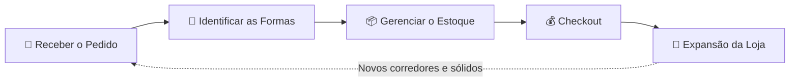
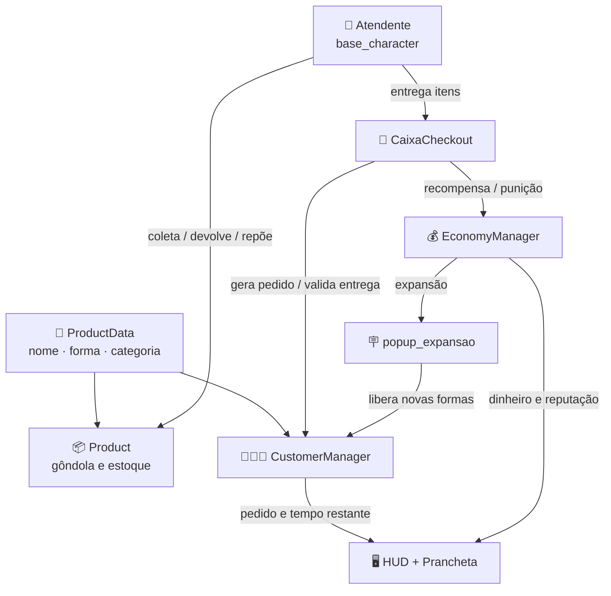

<div align="center">


### *Atenda rápido. Pense em formas. Domine a geometria.*

**Um Serious Game 2D top-down onde a matemática vira caos de supermercado.**

<br>


<br>

[🎮 **Jogar agora**](#-jogue-agora) · [⌨️ Controles](#️-controles) · [🛠️ Executar](#️-como-executar) · [🏗️ Arquitetura](#️-arquitetura-do-código) · [👥 Equipe](#-equipe)

</div>

---

## 📌 Sobre o Projeto

O **GeoRush** é um **Serious Game (Jogo Sério)** 2D top-down desenvolvido como parte da disciplina de **PAC Extensionista** do curso de **Engenharia de Software** (Católica SC).

O objetivo é auxiliar alunos do **Ensino Fundamental II (12 a 16 anos)** no **reconhecimento e classificação de Sólidos Geométricos**, transformando a teoria matemática pesada em uma experiência de gameplay **lúdica, rápida e imersiva**.

<div align="center">

| 🔵 Esfera | 🥫 Cilindro | 📦 Paralelepípedo | 🔺 Pirâmide | 🍦 Cone |
|:---:|:---:|:---:|:---:|:---:|
| Maçã, bola... | Lata, tubo... | Caixa, livro... | Pirâmide | Cone |

</div>

---

## 🎮 O Jogo

Você é o atendente de um **supermercado caótico**. Os clientes chegam, pedem produtos pelo nome, e cabe a você traduzir cada item para sua **forma geométrica** e entregar tudo antes que a paciência acabe.

### Core Game Loop



| Etapa | O que acontece |
|:---|:---|
| 🧾 **Receber o Pedido** | Atenda clientes gerados proceduralmente no caixa. |
| 📐 **Identificar as Formas** | Traduza a lista de compras (ex: *"Maçã"*, *"Lata"*, *"Caixa"*) para suas formas geométricas (*Esfera*, *Cilindro*, *Paralelepípedo*). |
| 📦 **Gerenciar o Estoque** | Colete itens nas prateleiras, devolva os errados e reponha estoques vazios com o dinheiro do caixa. |
| ⏱️ **Checkout** | Entregue os produtos antes que a paciência do cliente (tempo) se esgote. |
| 🏪 **Expansão** | Acumule dinheiro e reputação para expandir a loja, revelando novos corredores e sólidos mais complexos. |

---

## ⚙️ Principais Funcionalidades Técnicas

<table>
<tr>
<td width="50%" valign="top">

### 🧍 Geração Procedural de NPCs
Combinação aleatória de dezenas de texturas (roupas, peles e cabelos), gerando até **7.986 clientes visualmente únicos**.

</td>
<td width="50%" valign="top">

### 🤖 Máquina de Estados de IA
Clientes navegam por **Waypoints**, formam filas de forma inteligente, reagem emocionalmente ao atendimento e **abandonam a loja se ignorados**.

</td>
</tr>
<tr>
<td width="50%" valign="top">

### 💸 Economia Dinâmica
O **EconomyManager** escala ganhos e penalidades com base no tempo de resposta e na precisão do jogador. Reputação zero = **Game Over**.

</td>
<td width="50%" valign="top">

### 📈 Dificuldade Progressiva
O **CustomerManager** aumenta a complexidade (mais itens, menos tempo) conforme você expande os setores do mercado.

</td>
</tr>
<tr>
<td colspan="2" valign="top">

### 🎨 UI Responsiva e Animada
HUD sincronizado em tempo real, com **Tweens** para animações fluidas da prancheta e pop-ups flutuantes no cenário.

</td>
</tr>
</table>

---

## ⌨️ Controles

O jogo é jogado pelo **teclado**.

| Tecla | Ação |
|:---:|:---|
| <kbd>W</kbd> <kbd>A</kbd> <kbd>S</kbd> <kbd>D</kbd> / <kbd>↑</kbd> <kbd>←</kbd> <kbd>↓</kbd> <kbd>→</kbd> | Movimentar o personagem |
| <kbd>E</kbd> | Interagir (pegar pedido no caixa / coletar produto na gôndola) |
| <kbd>R</kbd> | Devolver o último produto coletado à prateleira |
| <kbd>F</kbd> | Repor estoque da prateleira *(custa dinheiro)* |
| <kbd>Tab</kbd> | Abrir/fechar a prancheta (lista de compras atual) |
| <kbd>Esc</kbd> | Pausar o jogo |

---

## 🌐 Jogue Agora

O projeto possui um **pipeline de CI/CD via GitHub Actions** que exporta automaticamente a build para **HTML5/WASM**.

<div align="center">

### 👉 [**Jogue direto no navegador!**](https://gabrielbruno.itch.io/georush) 👈

*(Nenhuma instalação necessária)*

</div>

---

## 🛠️ Como Executar

O projeto usa a arquitetura nativa da **Godot Engine**, portanto **não requer bibliotecas externas** (NPM, Pip, etc).

### 💻 Via código-fonte (Desenvolvedores / Avaliadores)

**Pré-requisito:** [Godot Engine 4.x](https://godotengine.org/download) (versão *Standard*, sem necessidade de .NET).

```bash
# 1. Clone o repositório
git clone https://github.com/GabBruno/GeoRush.git
```

1. Abra a **Godot Engine** e clique em **Import**.
2. Navegue até a pasta clonada e selecione o arquivo `project.godot`.
3. Clique em **Import & Edit**.
4. Pressione <kbd>F5</kbd> para compilar e iniciar o jogo em modo Debug.

### 🌍 Via Web (Jogadores)

Acesse o link da seção [Jogue Agora](#-jogue-agora) e comece a atender!

---

## 🏗️ Arquitetura do Código

O projeto adota boas práticas de **separação de responsabilidades** e **orientação a eventos**, organizado por **domínio** (núcleo, entidades, produtos, UI e fases) em vez de por tipo de arquivo.

```
GeoRush/
├── 📂 Assets/                    # Recursos visuais, sonoros e fontes
│   ├── Audio/                    #   Música (menu e fundo) e SFX
│   ├── Enviroment/               #   Tiles do cenário e porta
│   ├── Fonts/                    #   Pixelify Sans e RevMiniPixel
│   └── UI/                       #   Logo, ícones, prancheta, botões e barras
│
├── 📂 Core/                      # Cérebro do jogo (regras e sistemas globais)
│   ├── customer_manager.gd/.tscn #   Pedidos, timers de paciência e sólidos liberados
│   ├── economy_manager.gd        #   Dinheiro, reputação, expansões e Game Over
│   ├── hud_manager.gd            #   HUD: tempo, dinheiro, reputação e expansão
│   └── product_data.gd           #   Resource que define um produto (nome, forma, categoria, ícone)
│
├── 📂 Entities/                  # Tudo que existe e se move/interage no mercado
│   ├── Characters/
│   │   ├── base_character.gd     #   Atendente: movimento, carrinho e interações
│   │   ├── cliente.gd            #   Cliente: waypoints, fila e reações
│   │   ├── atendente.tscn · cliente.tscn · base_character.tscn
│   │   ├── Reactions/            #   Emojis de reação dos clientes
│   │   └── Visuals/              #   Camadas p/ geração procedural (Corpo, Cabelo, Roupa)
│   └── Interactables/
│       └── caixa_checkout.gd     #   Caixa: recebe pedido, valida entrega e paga
│
├── 📂 Products/                  # Catálogo de produtos
│   ├── product.gd                #   Gôndola: estoque, coleta, devolução e reposição
│   ├── base_products.tscn        #   Cena base reutilizada por todos os produtos
│   ├── Data/                     #   ProductData (.tres) de cada produto
│   ├── Icons/                    #   Ícones usados na prancheta e no carrinho
│   └── Scenes/                   #   Uma cena por produto (maçã, lata de milho...)
│
├── 📂 Levels/                    # Cenas das fases
│   ├── game_level.tscn
│   └── mercado_manager.tscn      #   Montagem do mercado, prateleiras e caixa
│
├── 📂 UI/                        # Menus e pop-ups
│   ├── menu_principal.gd/.tscn
│   ├── menu_pausa.gd/.tscn
│   ├── popup_expansao.gd/.tscn
│   └── theme_botoes.tres         #   Tema compartilhado dos botões
│
├── 📄 project.godot              # Configuração do projeto e AutoLoads
└── 📄 export_presets.cfg         # Presets de exportação (HTML5/WASM)
```

### 🔗 AutoLoads (Singletons)

| Singleton | Arquivo | Responsabilidade |
|:---|:---|:---|
| 💰 **EconomyManager** | `Core/economy_manager.gd` | Controla o cofre global, a reputação, o nível de expansão e a meta de clientes atendidos. |
| 🧑‍🤝‍🧑 **CustomerManager** | `Core/customer_manager.tscn` | Gera os pedidos, controla o timer de paciência e libera novos sólidos geométricos conforme a loja expande. |

### 🧩 Como as peças conversam



> 💡 **Dados desacoplados da lógica:** cada produto é um `Resource` (`ProductData`) editável direto no Inspector da Godot. Para adicionar um item novo, basta criar um `.tres`, uma cena em `Products/Scenes/` e posicioná-la no mercado, sem alterar nenhum script.

---

## 👥 Equipe

<div align="center">

| Integrante | Função |
|:---|:---|
| **Gabriel Aguiar Bruno** | 💻 Desenvolvedor Líder |
| **Gabriel da Cunha** | 🎲 Game Design e QA |
| **Iasmin Krueger** | 📋 Gestão do Projeto |
| **Julia Seger** | 🎨 UI/UX e Artes |
| **Vitor Turmina** | 🎧 Áudio e Testes |

</div>

---

<div align="center">

Projeto desenvolvido para a disciplina de **PAC Extensionista** · Engenharia de Software · **Católica SC**

⭐ Se gostou do projeto, deixe uma estrela no repositório!

</div>
